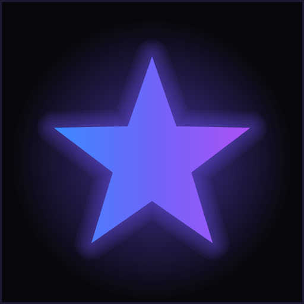

<p align="center"></p>

# ZeroVisual

Бесплатный open-source **легитный** визуальный клиент для Minecraft **1.21.4**, **1.21.11**, **26.3** (Fabric) и **1.8.9** (Forge).
Для тех, кто не может или не хочет платить за платные клиенты.

## Принципы

- **Только визуал, HUD и QoL.** Никакой автоматизации, увеличения хитбоксов и прочих преимуществ — клиент безопасен на серверах.
- **Бесплатно и открыто** навсегда (GPL-3.0).

## ⚠️ Название и официальные сборки

Код открыт (GPL-3.0), его можно менять. Но **название «ZeroVisual» и логотип нельзя использовать в изменённых версиях**. Форк должен называться иначе и не выдавать себя за ZeroVisual, особенно если в нём есть читы (ESP, X-ray и т. п.). Подробнее: [TRADEMARKS.md](TRADEMARKS.md).

Официальные сборки — **только** в [Releases](https://github.com/ZeroCoder407/ZeroVisual/releases). Они подписаны: изменённый или пересобранный клиент показывает в игре **«Неофициальная сборка»**.

## Установка

1. Установите [Fabric Loader](https://fabricmc.net/use/) для своей версии игры (1.21.4, 1.21.11 или 26.3).
2. Положите в папку `mods`:
   - `zerovisual-<версия>+<версия игры>.jar` — для своей версии игры
   - [Fabric API](https://modrinth.com/mod/fabric-api)
   - [Mod Menu](https://modrinth.com/mod/modmenu) — рекомендуется

Для **1.8.9**: установите [Forge 1.8.9](https://files.minecraftforge.net/net/minecraftforge/forge/index_1.8.9.html) и положите в `mods` только `zerovisual-<версия>+1.8.9.jar`.

## Эмоции и приватность

Обычный сервер не передаёт данные мода другим игрокам, поэтому эмоции между игроками с ZeroVisual идут через небольшой сервер-посредник ([relay/](relay)). Ему передаются только UUID игрока, название эмоции и хеш адреса сервера, ничего не сохраняется. Отключается в модуле EmoteMenu: «Show to other players».

## Музыка

MusicMenu (по умолчанию M) ищет сразу по YouTube, Audius, hearthis.at, Internet Archive, Jamendo и Openverse. Поиск идёт через тот же relay (ключи сервисов хранятся на нём), звук игра берёт прямо с сервиса, а YouTube играет в официальном плеере YouTube во вкладке браузера, которой игра управляет.

«Системный плеер» показывает в игре то, что играет в Windows (Яндекс Музыка, VK или YouTube Music в браузере, Spotify и т. д.), и управляет им: пауза, следующий трек, перемотка. Данные берутся из медиапанели Windows небольшим скриптом PowerShell, вход в аккаунты не нужен, с компьютера ничего не уходит. Отключается в модуле MusicMenu: «System player».

Для «Вместе» в комнату сервера уходят сервис, номер трека и позиция в нём (для системного плеера — название, исполнитель и приложение). Отключается в модуле MusicMenu: «Listen together».

## Сборка

Четыре Gradle-проекта: `1.21.4/` (JDK 21), `1.21.11/` и `26.3/` (JDK 25), `1.8.9/` (Gradle на JDK 21, сам мод собирается JDK 8: путь к нему в переменной `JAVA_HOME_8_X64`).

```bash
cd 1.21.4   # или 1.21.11, 26.3, 1.8.9
./gradlew build
```

Готовый `.jar` — в `build/libs/` нужной папки. Запуск клиента для разработки: `./gradlew runClient`.

## Лицензия

Код: [GPL-3.0](LICENSE). Название и логотип ZeroVisual лицензией не передаются (GPL-3.0, пункт 7(e)), см. [TRADEMARKS.md](TRADEMARKS.md).
